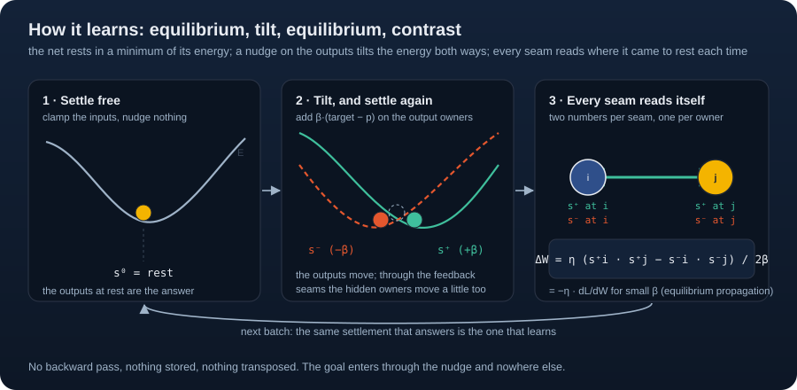

<p align="center">
  
</p>

# Cadence

[Pragma Research](https://floatingpragma.io/) · [Documentation](https://github.com/muellerberndt/cadence/blob/main/docs/README.md) · [Application demos](https://github.com/muellerberndt/cadence-demos) · [Paper](https://philpapers.org/rec/MUECAP-2) · [PyPI](https://pypi.org/project/cadence-net/)

[](https://github.com/muellerberndt/cadence/actions/workflows/ci.yml)
[](https://github.com/muellerberndt/cadence/blob/main/LICENSE)

**One continuing equilibrium brain: learn a world, act in it, repair what fails.**

Cadence is a Python library (NumPy, Python 3.11 or later) for brains that settle rather than
compute a pass: a graph of rate neurons relaxes to an equilibrium under the observation, the
action is read from that equilibrium, and every synapse learns from the difference between two
settles, with no backward pass and no training/inference switch.

```sh
python -m pip install cadence-net==0.93.1
```

```python
import numpy as np
from cadence import Brain

brain = Brain.compose(inputs=4, actions=2, arousal=True)
observation = np.array([[1.0, 0.0, 0.0, 0.0]])
action = brain.live(observation)

# A tiny environment rewards action 0 and supplies the next observation.
reward = (action == 0).astype(float)
next_observation = np.array([[0.0, 1.0, 0.0, 0.0]])
action = brain.live(next_observation, reward=reward)
assert action.shape == (1,)
```

By default `Brain.compose` builds one association region of 64 neurons between the senses and
the motor choice, settling together with them; a working trace that carries the last
interpretation into the next settle; and an associative store that keeps each situation's
outcomes. Under `live` the brain learns while young (its first 100 moments) or aroused by
surprise or want, and otherwise answers greedily from one settle; under `step` it learns from
every outcome and from `teacher=` labels. Everything else is opt-in: System 2 observers, the
episodic memory, the recall memory, a learned code, images.

| You want to | Read |
| --- | --- |
| run a creature that lives, acts and learns | [Start a continuing brain](https://github.com/muellerberndt/cadence/blob/main/docs/start.md) |
| teach by demonstration | [Teach by demonstration](https://github.com/muellerberndt/cadence/blob/main/docs/teach.md) |
| let the world pay for good acts | [Learning from reward](https://github.com/muellerberndt/cadence/blob/main/docs/reward.md) |
| give the brain a memory for a task | [Memory](https://github.com/muellerberndt/cadence/blob/main/docs/memory.md) |
| read or change a living brain | [Tune and read a living brain](https://github.com/muellerberndt/cadence/blob/main/docs/tune.md) |
| a signature | [API reference](https://github.com/muellerberndt/cadence/blob/main/docs/api.md) |

The [documentation index](https://github.com/muellerberndt/cadence/blob/main/docs/README.md)
lists the rest: wide inputs, growing and grafting, evaluation, your own anatomy, how the
brain settles, backends; the
[released documentation](https://github.com/muellerberndt/cadence/blob/v0.93.1/docs/README.md)
describes the APIs of the installed package. Integrated learned world prediction, repair
localized to what failed and cheap stable operation are work in progress; Cadence is alpha
research software.

<a id="get-started"></a>

## Start with System 1

`live` takes the **preceding action's** measured reward, then chooses the next
action for one continuing stream; supply one observation row per call. It needs
`arousal=True` (the founder arousal settings). The working trace advances at every
accepted moment; with the opt-in recall memory (`recall=True`) its slots advance at
every accepted moment too. Tune named settings with `compose` or `brain.retune(...)`
and inspect them with `brain.describe()`
([tune and read](https://github.com/muellerberndt/cadence/blob/main/docs/tune.md#defaults-and-expert-overrides)).
[Continuous interaction](https://github.com/muellerberndt/cadence/blob/main/docs/start.md#continuous-interaction)
covers arousal, resets and saved continuation.

For explicit teaching, batched streams or learning from every outcome, use the
lower-level `step` loop, which works with or without `arousal=True`; its
`teacher=` labels the current observation. The
[continuing brain example](https://github.com/muellerberndt/cadence/blob/main/examples/continuing_brain.py)
runs that loop through changed conditions and saved continuation.

A teacher label changes graph parameters. The default associative memory
ignores labels. Add `memory_choice=True` when remembered demonstrations and outcomes should
vote in the choice. Add `learned_code=units, attention=True` when the brain should retrieve a
relevant recent context and its successor, and `recall_heads=k` when one answer needs several
witnessed facts at once. The options can be used together.
[Memory](https://github.com/muellerberndt/cadence/blob/main/docs/memory.md#start-with-the-need)
starts with these common cases before giving the complete reference.
A brain trained without one of them gets it later: `brain.grow(recall=True)`, or new output
slots with `brain.grow(slots=...)`, returns a new brain, the trained one with the part added,
settling as the trained one did until learning gives the part weight. `brain.graft(donor, ...)` puts trained
regions of another brain into a larger one, such as a trained visual system, or a whole
connectome as one region of a larger anatomy
([grow and combine brains](https://github.com/muellerberndt/cadence/blob/main/docs/grow.md)).

```python
phases = brain.imagine([observation, next_observation])
assert phases  # Inspect phase.qualified before using an imagined response.
```

Imagination carries a private trace without changing live memory, random state
or pending feedback; the composed brain builds no model of the world's
consequences.

Each action solve reports its residual, qualification, sweeps and check counts
in read-only `brain.last_settlement`, as
[start a continuing brain](https://github.com/muellerberndt/cadence/blob/main/docs/start.md#inspect-the-work-of-answering)
shows. An action whose settle exhausts its budget is refused without changing
live state; [qualification and refusal](https://github.com/muellerberndt/cadence/blob/main/docs/start.md#qualification-and-refusal)
says when to retry `live(observation)` without resubmitting the reward.

<a id="development-checkout"></a>

To work from source, install the library repository root as an editable package:

```sh
python -m pip install -e .
```

## Add optional System 2

```python
recursive = Brain.compose(
    inputs=4, actions=2, modules=(16, 8), observers=(8,), seed=7,
    arousal=True,
)
```

Observer regions read and return influence to the base, motor regions and earlier
observers. They join the same settlement and use the same interaction interface.
Whether recursive feedback helps on a task is a question for experience and
evaluation.

## How a Cadence brain differs from a feed-forward network

`Brain.compose(inputs=4, actions=2, modules=(64, 32, 16))` builds reciprocal
regions whose activity settles together, so later regions shape earlier ones
while an answer forms, and the action comes from the qualified neural state.
The learner compares local activities in a free and a nudged phase, without a
backward differentiation pass. The relevant comparison with a recurrent
backprop network is acquired behavior and total work on the same task, as
[the comparison below](https://github.com/muellerberndt/cadence/blob/main/README.md#compared-with-a-backprop-network)
sets out; other model families have
[their own learning contracts](https://github.com/muellerberndt/cadence/blob/main/docs/contracts.md).

## Why Cadence

The library puts continuing state, reciprocal interpretation, local plasticity
and memory behind one small interface. A saved brain resumes an action that
awaits its actual outcome, and private imagination inspects responses without
rewriting live experience. These are mechanisms for testing acquisition,
retention and recovery through a life. Biological names describe functional
software roles;
[one continuing equilibrium brain](https://github.com/muellerberndt/cadence/blob/main/docs/world-model.md)
states the design direction.

The target includes full-sentence language and reusable world understanding;
a small fixed-label task is a control.

## For machine-learning readers

This section maps Cadence onto models you know: which brain corresponds to which
familiar model, where each one's learning signal comes from, what the arrays look
like and what the words mean. The application interface is
`Brain.compose(..., arousal=True)`, then `brain.live(observation, reward=...)` for
each real outcome ([tune and read](https://github.com/muellerberndt/cadence/blob/main/docs/tune.md), [start a continuing brain](https://github.com/muellerberndt/cadence/blob/main/docs/start.md)); the
families below are the numerical mechanisms underneath and beside it.

### The picture

A Cadence brain is a set of patches joined by ports. A patch holds a bounded local
state (the potentials of a group of neurons, or one context vector), reads its
inputs through ports and updates by its declared equations. Graph models qualify a
settled state and learn from detuned phases. The [contract guide](https://github.com/muellerberndt/cadence/blob/main/docs/contracts.md)
separates these cases.



### Against models you know

| Cadence | Nearest familiar model | What is different |
| --- | --- | --- |
| Settling brain (`Genome`, `develop`, `NeuralGraph`, `Learner`) | A continuous Hopfield or energy-based recurrent network trained by [equilibrium propagation](https://arxiv.org/abs/1602.05179): rate neurons relax to a fixed point, and the gradient is the contrast of a free and a nudged fixed point. | Any wiring, including a measured connectome. Reciprocal learning ties paired weights; an arbitrary directed import need not satisfy the gradient contract. A [certificate](https://github.com/muellerberndt/cadence/blob/main/docs/settling.md#the-settling-certificate) says when settling is a contraction and how far the answer is from the equilibrium. Reward learns through eligibility traces and one broadcast prediction error. |

The composed brain's memories key on the observation, on the fixed sparse code
`code=units` ([the observation code](https://github.com/muellerberndt/cadence/blob/main/docs/senses.md#the-observation-code)),
or, opt-in, on a code the brain learns while it lives (`learned_code=units`,
[the learned code](https://github.com/muellerberndt/cadence/blob/main/docs/senses.md#the-learned-code)),
both described under *Code* in the glossary. `evolve` mutates and selects genomes across lives
([evolution](https://github.com/muellerberndt/cadence/blob/main/docs/anatomy.md#evolve-a-brain)).
The opt-in `Brain.compose(..., learned_code=units, attention=True)` recipe uses that learned
code as a two-moment Recall address and holds one selected memory read through the shared
settle; with `recall_heads=k` it reads the same memories through k heads, each learning its
own address
([several heads](https://github.com/muellerberndt/cadence/blob/main/docs/memory.md#several-heads-opt-in)).
No read revises its query during that settle
([memory guide](https://github.com/muellerberndt/cadence/blob/main/docs/memory.md#single-head-learned-code-attention-opt-in)).

### Where the learning signal comes from

- **The settling brain uses no backward pass through time.**
  The free settle is the answer. A second settle with the outputs nudged by `beta`
  toward the target and a third nudged away give every synapse the
  product of its two neurons in each phase; the difference over `2 beta` is the
  update. On a smooth stable equilibrium with symmetric effective weights the contrast
  tends to the loss gradient as `beta` tends to zero
  ([learning](https://github.com/muellerberndt/cadence/blob/main/docs/settling.md#5-why-the-contrast-is-a-gradient)). At a finite `beta` it is
  an estimate with a `beta^2` error term and a phase-solve term that grows as
  `1/beta`; the default activation's kink at zero lies outside the smooth-branch
  argument. [benchmarks/local_equilibrium](https://github.com/muellerberndt/cadence/blob/main/benchmarks/local_equilibrium/README.md)
  compares the contrast learner with an implicit-gradient learner on the same network.
- **Memory stores learn by one write** of the error into the rows of the key, so two
  keys share records exactly as far as they overlap
  ([one correction](https://github.com/muellerberndt/cadence/blob/main/docs/memory.md#one-correction)).
- **Reward** enters the settling brain as a broadcast prediction error gating every
  synapse's eligibility trace, a three-factor rule ([reward](https://github.com/muellerberndt/cadence/blob/main/docs/reward.md)).

### Compared with a backprop network

| | A network trained by backprop | A Cadence brain |
| --- | --- | --- |
| Reading an answer | Evaluate the layers | Settle to a fixed point with a residual check |
| State between inputs | A cache or a separate memory | A settled state, a carried context, a trace or a memory store, each explicit |
| Credit | Reverse-mode differentiation | Free and nudged contrasts for the settling brain; delta-rule writes for the memory stores |
| Exact-gradient conditions | A differentiable computation | For the contrast: a stable smooth equilibrium, symmetric effective weights, converged phases and a vanishing nudge |
| Work | A forward and a backward pass | Every step of the free and nudged phases plus the update |
| Memory of one event | A replay buffer or fine-tuning | One write into the store, read back at the same reading |
| Hardware | GPU tensors | NumPy float64 on the CPU; optional torch, MLX or Numba for the settling brain's graph transport ([backends](https://github.com/muellerberndt/cadence/blob/main/docs/backends.md)) |

The table compares update mechanisms. Networks trained by backprop can also be
recurrent, online, model-based and memory-using, so a fair comparison measures
acquired behaviour and total work on the same task and information.

### Shapes

| Model | Inputs | Targets | State between calls | Checkpoint |
| --- | --- | --- | --- | --- |
| Composed `Brain` | `(batch, inputs)` observations; one row for `live` | `step(teacher=...)` labels the current observation; reward labels the preceding executed action | Neural activity, working trace, optional efference copy, heard history, recall slots and their address map, the associative and episodic stores with the episodic temporal context, pending outcomes | `Brain.save` / `Brain.load` keep the complete continuation |
| Neural graph / `Learner` | a drive `(batch, n)`, one column per neuron; features go on the input neurons | integer labels `(batch,)` or `(batch, slots)` for `Learner.step`, or a target pattern `(batch, n)` for the phase calls | `BrainState` per row; pass `warm=` to continue | `Learner.save` / `Learner.load`, one `.npz` |

Batch rows are independent streams sharing parameters. `imagine` is private: it
changes no learned parameter, record or live activity, though cost counters may count
its work.

### Glossary

- **Patch.** A bounded unit with local state, ports, readback and a repair rule: a
  group of neurons with their synapses.
- **Port.** A declared band of a patch's state that another patch, or the world,
  reads or drives: a population of a connectome.
- **Settle, settling.** Repeating local updates under fixed evidence. A settle
  qualifies when the component's declared equation or stationarity check passes; small
  movement or an exhausted iteration budget is insufficient.
- **Equilibrium.** A state satisfying the component's settlement contract under fixed
  boundary conditions. For the neural graph these include drive, parameters and held
  memory readback.
- **Residual.** A model-specific number, for the neural graph the equation error
  ([contracts](https://github.com/muellerberndt/cadence/blob/main/docs/contracts.md)). A residual says nothing about task success.
- **Certificate.** The contraction bound that says settling has a unique equilibrium
  and how far the last step's movement leaves the state from it.
- **Free phase, nudged phase, beta.** The settle under the inputs alone; the settle with
  the outputs pulled toward (or away from) the target with strength `beta` (default 0.1),
  where smaller is closer to the gradient and weaker; the plus and minus `beta` phases are
  contrasted over `2 beta`.
- **Detuning, contrast.** Perturbing an equilibrium and reading the difference between
  the perturbed and the free state; the learning signal of the settling brain.
- **Code.** The fixed random expansion of an observation onto `expansion` units, of which
  the `winners` strongest positive entries stay (`code=units`, `PatternSeparator`); the
  sparse key of a store. The learned code (`learned_code=units`, `LearnedCode`) is a region
  of the brain's own neurons that settles to a sparse code of the observation and learns it
  by local rules while the brain lives; the cortex reads it, and every memory keys on it
  joined to the observation's own identity.
- **Readback.** The detached state, residuals, counters and revision of a patch, as
  observations an application or another patch's port can read.
- **Genome, develop, region, cortex, projection.** The declaration of a settling
  brain's regions and projections; its deterministic layout into one connectome; a
  named population; a builder of a standard region; a declared bundle of synapses.
- **Connectome.** The synapse list of a settling brain (`pre`, `post`, `count`, `sign`)
  and its named populations.
- **Efficacy, gain, log_gain, bias.** The learned signed strength of a synapse; the
  neuron model's global gain (`NeuronModel.gain`); the per-neuron scale of a neuron's
  outgoing synapses, applied as `exp(log_gain[pre])` and fixed by the learner; the
  learned per-neuron offset.
- **Eligibility trace, dopamine.** Per-synapse memory of recent contrasts; the broadcast
  prediction error, capped, that gates them.
- **Receipt.** A JSON file binding a result to the sources that produced it, with a
  digest and a verifier ([receipts](https://github.com/muellerberndt/cadence/blob/main/docs/evaluate.md#receipts)).

### Reading the numbers

Measure settling, learning and memory maintenance separately on the same held-out data, and compare against the simple control the task
admits: the majority outcome, persistence, a linear predictor, the search alone or the
algorithmic solver. [Evaluate a brain](https://github.com/muellerberndt/cadence/blob/main/docs/evaluate.md) lists the checks and
[common missteps](https://github.com/muellerberndt/cadence/blob/main/docs/evaluate.md#common-missteps).

### Further reading

- Learning rule: [equilibrium propagation](https://arxiv.org/abs/1602.05179) and its
  [centered estimator](https://arxiv.org/abs/2006.03824).
- Memory stores: the cerebellar sparse expansion with a linear readout of
  [Marr (1969)](https://doi.org/10.1113/jphysiol.1969.sp008820) and
  [Albus (1971)](https://doi.org/10.1016/0025-5564%2871%2990051-4); the
  [delta-rule fast-weight memory](https://arxiv.org/abs/2406.06484); fast and slow
  [complementary learning systems](https://web.stanford.edu/~jlmcc/papers/McCMcNaughtonOReilly95.pdf)
  (McClelland et al., 1995) with their retention and interference tradeoffs.
- Reward: [prediction errors](https://www.gatsby.ucl.ac.uk/~dayan/papers/sdm97.html)
  (Schultz et al., 1997); eligibility-based online recurrent learning
  ([Bellec et al., 2020](https://www.nature.com/articles/s41467-020-17236-y)), from
  whose e-prop Cadence's rule differs.
- Acquisition and language: word/referent learning across ambiguous situations
  ([Smith and Yu, 2008](https://pmc.ncbi.nlm.nih.gov/articles/PMC2271000/)); live
  interaction in infant phonetic learning ([Kuhl et al., 2003](https://doi.org/10.1073/pnas.1532872100));
  communication and thought as distinct ([Fedorenko et al., 2024](https://www.nature.com/articles/s41586-024-07522-w));
  [speech-planning experiments](https://pubmed.ncbi.nlm.nih.gov/26858678/) on
  incremental formulation.

The [paper](https://philpapers.org/rec/MUECAP-2) states the hypotheses, the theorems
and the evidence.

## Go further

[MANIFESTO.md](https://github.com/muellerberndt/cadence/blob/main/MANIFESTO.md)
states the design points, including the language goal of whole consistent
sentences from the settled state.
[Your own anatomy](https://github.com/muellerberndt/cadence/blob/main/docs/anatomy.md)
covers custom wiring.
[cadence-demos](https://github.com/muellerberndt/cadence-demos) contains the
application demos.

[Documentation](https://github.com/muellerberndt/cadence/blob/main/docs/README.md) ·
[API](https://github.com/muellerberndt/cadence/blob/main/docs/api.md) ·
[Contributing](https://github.com/muellerberndt/cadence/blob/main/CONTRIBUTING.md) ·
[Changelog](https://github.com/muellerberndt/cadence/blob/main/CHANGELOG.md) ·
[Research tasks](https://github.com/muellerberndt/cadence/issues)

Licensed under [GPL-3.0](https://github.com/muellerberndt/cadence/blob/main/LICENSE).

<details>
<summary>Related projects and funding</summary>

[Observer Patch Holography](https://github.com/FloatingPragma/observer-patch-holography)
(OPH) is the related physics project. Its physics evidence is separate from
Cadence's capability evidence.
[Pragma Research](https://floatingpragma.io/) brings the projects together.

Cadence has an official memecoin on Solana, deployed by the Solana community.
Its token address is `46doJPsSjEVMsNZm4b32UbbvbUXjFTM3TDPBWMM3pump`
([chart on Dexscreener](https://dexscreener.com/solana/4tjiqzqocttntmdqqmev2spoegzipuerfyramnfxv9su)).
Its trading fees are routed to Bernhard Mueller to fund the project. Pragma
Research holds none of the token. Cadence itself does not use it, and no
integration into the core library is planned. We encourage the crypto community
to build interesting projects that integrate it. Any other token using the
Cadence name is unrelated to this project. Nothing here is financial advice.

</details>
