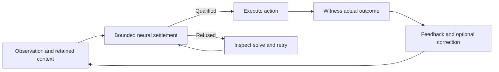

# One continuing equilibrium brain

**Cadence is not a feed-forward deep neural network.** Its organizing idea is a
continuing equilibrium brain that acquires a reusable interpretation of
its world, carries it through experience, and repairs it when experience disagrees.
Perception, memory and action should constrain one another through reciprocal
connections. The answer belongs to the brain's settled state. Reading its motor
choice exposes that state; a separately trained answer-producing decoder would
be another model.

Start with `Brain.compose`: the default **System 1** has reciprocal processing
regions, local plasticity, working trace and fast/persistent associative memory.
It can already be deep. Optional **System 2** adds observing regions with returning
feedback inside the same neural settlement. Biological names describe software
roles, not a literal biological implementation.

**Simple first; animal brains are the reference.** Local agreement repair
between patches into one coupled global equilibrium is the fixed foundation. Try
the existing System 1 before adding structure, and check state, experience,
sensory information, memory and implementation first. Cadence abstracts evolved
functions, including finite capacity and possible rigidity; equilibrium does not
promise perfect learning. Every addition uses the same local repair and
settlement and preserves demonstrated capabilities under the
[required mechanism review](../CONTRIBUTING.md#preserve-the-capable-foundation).

For settling, recovery and cost research, start with
[existing distributed-systems and operator results](settling.md#related-results-and-their-assumptions).
Map their assumptions to the actual continuing brain before extending a theorem
or changing a mechanism. Use existing context, retention and work fixtures to
decide whether a bound improves diagnosis or execution; a linear compatibility
model does not itself certify the nonlinear, learning life.

| Inconsistent with the intended application | Right organizing lifecycle |
| --- | --- |
| Rebuild a classifier for each observation, bypass memory, and count label accuracy as a world model. | Bootstrap one brain, retain its acquired relations and memory, use it, witness failures, repair and continue. |
| Have an external trained readout or language model supply the answer. | Let reciprocal regions constrain the answer read from the brain's declared motor population. |
| Call any small residual a correct, cheap interpretation of the world. | Check the numerical equations, actual task outcomes, retention and measured work separately. |

Isolated classifiers and calibration remain useful unit controls. The distinction
is what capability the application demonstrates, not whether those tests exist.


## Bootstrap, use, repair, continue

1. **Bootstrap a useful interpretation.** Present real observations, consequences
   and demonstrations to one brain. Let connections and memory acquire relations
   that can support later answers with the teaching signal absent. Judge usefulness
   on held-out experience and retention, separately from numerical settlement.
2. **Operate with what was learned.** New evidence and remembered context change
   the boundary of the solve. Reciprocal regions seek a compatible present state;
   the brain acts and the environment supplies the actual consequence.
3. **Repair a witnessed failure.** The application compares an issued action or,
   when its chosen model supplies one, a saved prediction with the observed
   outcome before correction. A false expectation or missed goal supplies task
   evidence; a large equation residual instead means the numerical solve has
   not qualified. `Brain.live` receives that measured reward; it does not make
   an environmental transition prediction or compare a corrected utterance.
4. **Resume the same life.** Retain acquired parameters, relevant memories and
   pending feedback through correction. Measure recovery and old capabilities
   after the disturbance, without rebuilding the brain for each observation.



The [common missteps](evaluate.md#common-missteps) list what this lifecycle rules out.

The stored relationships and memories encode a **family of possible equilibria**
under different evidence and context. Learning changes that family. Ordinary use
does not mean holding one activation vector forever: even a well-learned world
requires different states as observations, goals and context change.

In `Brain.compose` the patch boundaries are sensory and motor neuron indices,
readback exposes neural state and numerical residuals, and the retained records
are working traces and learned cue/outcome associations. Reciprocal signals and
local plasticity supply feedback and repair. A numerical
fixed point checks the declared equations only: not external truth, useful
meaning, retention or a unique stable interpretation.

**One moment in causal order.**

1. Receive the observation and the feedback for the **preceding action**.
2. Score its saved prediction before the learner sees the outcome. Update from the
   observed components and apply reward to the saved eligibility of that action.
3. Retain relevant actual events with their time, context and provenance.
4. Combine current evidence, remembered events and the goal. Imagination uses
   isolated branch state and read-only parameters.
5. Save the next prediction, execute the action or utterance, and attend to the
   result.

A missing feature differs from an observed zero: give the reading a missing flag
for it, in witnessed and imagined readings alike. A UI tick or other host event is
no action outcome; report each issued action's outcome once, success included.

`Genome`/`develop` connect regions by declared
synapses. Put regions that should settle jointly into one `NeuralGraph`;
independent solves shown side by side are uncoupled dynamics. Wire an auxiliary
memory's recall into declared drive ports and count its store in the cost. A
named region gets a function only from its connections and experience.

## Coherent behavior over time

The intended sequence capability is behavior governed by continuing learned
context. A phrase, sentence or action sequence can unfold one event at a time,
with sensory feedback; working traces, associative memory and efference are the
mechanisms that carry the context. Next-event accuracy or a self-feeding rollout
is component evidence, not acquired phrase or sequence competence.

Test whether learned context governs continuation: retain it, remove or perturb
it under matched exposure, and measure recovery and counterfactual contexts.
Musical surprise, coherent development and successful action are separate
observations; a surprising event need not be a numerical failure.

The memory goal is **learned relevance**: the same acquired brain uses the same
memories differently when the question, goal or context changes, and experience
improves that selection. Retention asks whether information survives; selection
asks which retained information shapes the present interpretation; temporal
credit asks which earlier actions learn from an outcome. Success at one does
not establish the others.

That selection must arise through local repair within the same coupled
equilibrium. Fixed keys, an adapter-supplied relevant-memory index or a vote
added after settlement do not establish this goal. The opt-in episodic memory
currently uses fixed observation/history keys and adds its vote to the motor
readout after the neural solve. Its measured benefits remain component evidence;
learned memory relevance is not yet demonstrated. Begin with the existing state
and memory, without prescribing a new module. The
[task protocol](task-design.md#test-learned-memory-relevance) tests changed
queries against identical saved memories, generalization, interference and
recovery before a sentence-learning claim depends on that capability.

Default `Brain.act` solves the present neural state while trace and memory input
are held. That is not a joint equilibrium over future events. The goal prescribes
no phrase module and no whole song in one solve: begin with the simplest existing
brain and its experience, and keep any addition inside the same coupled
equilibrium. An adapter must not supply the answer, the phase or the arrangement
on the brain's behalf.

Declare component versus integrated scope in the
[task's evidence contract](task-design.md#test-coherent-behavior-over-time).
The [roadmap](https://github.com/muellerberndt/cadence/issues/109) and its goal epics keep these targets distinct
from current implementation claims.

## What the current interface provides

The current `Brain` supports a continuing equilibrium interpretation, action and
memory. This realizes part of the world-model hypothesis; it does not yet
integrate a learned model of environmental transitions. For one creature, compose
a brain with arousal and use `live` throughout its life. It receives the preceding
action's measured outcome and chooses the next action, with arousal deciding
when to explore and learn. This small loop keeps one stream and both memory
pathways active:

```python
import numpy as np
from cadence import Brain

brain = Brain.compose(inputs=2, actions=2, arousal=True)
observations = np.eye(2)
cue = 0
action = brain.live(observations[[cue]])

for transition in range(8):
    # The toy body's rule changes halfway through this continuing life.
    target = 1 - cue if transition < 4 else cue
    reward = (action == target).astype(float)  # actual executed action
    cue = 1 - cue
    action = brain.live(observations[[cue]], reward=reward)

assert brain.learner.updates > 0
assert brain.hippocampus is not None and brain.hippocampus.writes > 0
```

Eight outcomes exercise continuing feedback through a changed environment; they
do not establish acquisition or recovery. For batches, supplied teachers or
learning from every outcome, use `step`. The
[runnable lifecycle example](../examples/continuing_brain.py) separates
bootstrap, unchanged conditions and changed conditions, records actual outcomes,
and verifies identical continuation from a saved pending action.
[Continuous interaction](start.md) specifies event order, refusal/retry,
memory writes and reset semantics. Save the environment separately.

The contract and boundary of each mechanism are tabled under
[one continuing equilibrium brain](start.md#one-continuing-equilibrium-brain).

The full world-model lifecycle is the design direction, not a completed default.
`step` processes real feedback even when the task succeeded; it does not gate an
update on witnessed failure. [`live`](start.md#routine-and-repair-live)
gates learning by arousal for one stream: routine moments settle once and change
no parameter or record, while a surprising outcome or a lasting reward shortfall
starts exploration and learning. Youth and sustained arousal also learn from
success, so this is not a failure-only gate. Its evidence is the
[odour nursery](../benchmarks/reversal/README.md), where the associative memory
carries the repair. Settled-state reuse across moments, repair localized to
declared dependencies and integrated learned consequences are owned by
[learned-consequence integration](https://github.com/muellerberndt/cadence/issues/93)
and [failure-driven repair and qualified reuse](https://github.com/muellerberndt/cadence/issues/122).

The current reward rule updates from actual outcomes. Its update, eligibility and memory
costs remain visible; arousal selects which continuing moments learn through `live`.

The default sensory projection feeds a chain of processing regions; neighboring
regions and the association/motor pair exchange reciprocal signals. Processing
regions have no internal synapses by default. Even `modules=(64,)` therefore
uses recurrent settlement with memory, rather than a single feed-forward pass.
More modules or optional observers change connectivity; their behavioral benefit
must be measured. See [the numerical contracts](contracts.md)
for the distinction between stochastic innovation and a learning error.

## Build and measure the whole life

Keep the same brain across acquisition, use, interference and repair. Preserve
stream identities and reset transient state only at declared boundaries.
Each stream keeps its own episode records, random state and pending
actions; `SynapticMemory` shares its slow weights across streams, so a
measurement snapshot must leave the live learner's shared matrix unchanged.
`Brain.save` covers the standard composition; save the environment, partner,
curriculum and replay state beside it, and custom stores with their owner.
`predict`, `accuracy` and `fit` are independent-sample controls: they omit
working and associative memory, and `fit` clears pending stream state. A frozen
evaluation can load a checkpoint, provided it retains the state the tested
capability needs.

For language, the intended result is understanding and producing full sentences
with compositional vocabulary through that continuing system. A fixed word
classifier tests a narrower mechanism, and an external language model or trained
readout that supplies the answer is a separate baseline, not the brain's
acquired language.

Measure numerical residuals, task quality, memory retention, recovery and work
separately, and count bootstrap, stable use, learning, replay, imagination and
refused attempts. Greater capability, scalability and efficiency are targets for
matched comparisons, not consequences of the word equilibrium.

Continue with [the continuing brain](start.md), [composition and tuning](tune.md),
[task design](task-design.md) and [evaluation](evaluate.md).
